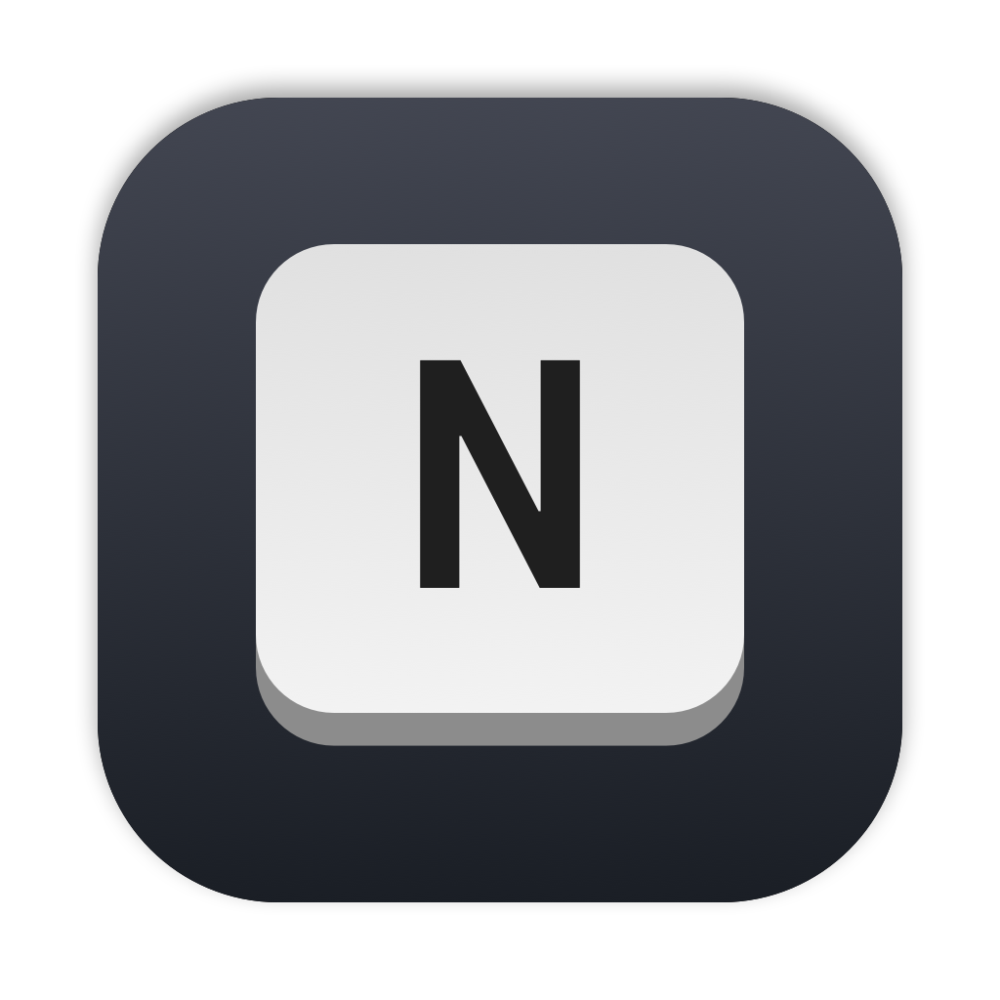
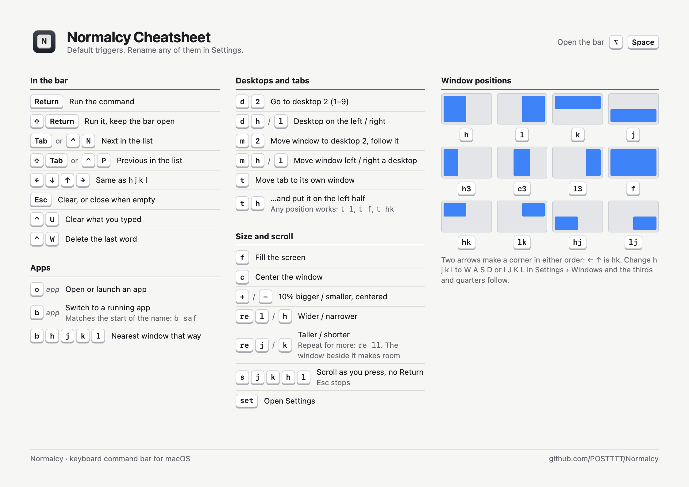

<div align="center">



# Normalcy

**Press a key. Type `h`. The window snaps left.**

A keyboard command bar for macOS, inspired by Neovim's normal mode:
short commands for apps, desktops, tabs and windows, without touching the mouse.

[](https://www.apple.com/macos/)
[](https://swift.org)
[](#commands)

</div>

```
   ⌥ Space ──▶ type  b saf  ──▶ Return ──▶ Safari is in front
   ⌥ Space ──▶ type  re ll  ──▶ Return ──▶ window two steps wider, the one beside it narrower
```

- **Vim-style triggers.** `h` `j` `k` `l` for halves, `h3` `c3` `l3` for thirds,
  `hk` for the top-left quarter, `d 2` for desktop 2. Arrow keys work too.
- **Everything is yours to rename.** Every trigger, and the direction keys
  themselves: pick W A S D or I J K L and the thirds and quarters follow.
- **See before you commit.** A translucent box shows where the window will go,
  `d` and `m` show your desktops as thumbnails, and `b` previews the app's window.
- **Keep going.** Shift+Return runs a command and keeps the bar open for the next one.
- **Stays out of the way.** A menu bar app with no Dock icon. The bar appears on
  the hotkey and disappears when you're done.

## Cheatsheet

[](docs/cheatsheet.html)

Every default trigger on one page. Open [`docs/cheatsheet.html`](docs/cheatsheet.html) in a browser and print it (A4 landscape) to keep it by your keyboard.

## Requirements

- macOS 14 or later
- Swift 5.9 or later (Xcode or the Command Line Tools)

## Install

```sh
git clone https://github.com/POSTTTT/Normalcy.git
cd Normalcy
swift run Normalcy
```

Normalcy lives in the menu bar as a ⌘ icon. On first launch macOS asks for:

- **Accessibility**, to move windows, move tabs and switch desktops. When you
  start Normalcy with `swift run`, macOS grants it to your terminal app, so turn
  that app on in System Settings › Privacy & Security › Accessibility.
- **Screen Recording** (optional), for desktop thumbnails and app previews.
  Without it, every desktop shows your wallpaper and `b` shows app icons.

## Using it

Press **Option+Space** to open the command bar, type a command, press **Return**.

| Key | What it does |
| --- | --- |
| **Return** | Run the command |
| **⇧ Return** | Run it and keep the bar open for the next one |
| **Tab** / **⌃N** | Next in the list (**⇧ Tab** / **⌃P** for the previous one) |
| **← ↓ ↑ →** | Same as `h` `j` `k` `l`. Two arrows make a corner: ← ↑ is top-left |
| **Esc** | Clear what you typed, or close the bar when nothing is typed |
| **⌃U** / **⌃W** | Clear everything / delete the last word |

Return on a highlighted command that needs more (like `o`) fills in its trigger
so you can keep typing. The list matches by trigger or by name: `half` finds all
four half-screen commands.

## Commands

These are the default triggers. Change any of them in Settings.

### Apps

| Command | Action |
| --- | --- |
| `o Safari` | Open or launch an app. The list shows your installed apps |
| `b saf` | Switch to a running app whose name starts with the text. The list shows what Cmd+Tab shows: apps with a window on this desktop, plus Finder, most recent first |
| `b h` / `b l` / `b k` / `b j` | Switch to the nearest window on the left / right / above / below |

### Desktops and tabs

| Command | Action |
| --- | --- |
| `d 2` | Go to desktop 2 (1–9) |
| `d h` / `d l` | Go to the desktop on the left / right |
| `m 2` / `m h` / `m l` | Move the current window to desktop 2 / left / right, and follow it |
| `t` | Move the current tab into its own window |
| `t h` | Move the current tab into its own window, on the left half (any window position works) |

### Windows

| Command | Action |
| --- | --- |
| `h` / `l` / `k` / `j` | Left / right / top / bottom half |
| `h3` / `c3` / `l3` | Left / center / right third |
| `hk` / `lk` / `hj` / `lj` | Top-left / top-right / bottom-left / bottom-right quarter |
| `f` / `c` | Fill the screen / center the window |
| `+` / `-` | 10% bigger / smaller, staying centered |
| `re l` / `re h` / `re j` / `re k` | Wider / narrower / taller / shorter by 5% of the screen. Repeat the key for more steps: `re ll` |
| `s` then `j` / `k` / `h` / `l` | Scroll down / up / left / right as you press the keys, no Return needed. Esc stops |
| `set` | Open Settings |

When two windows sit side by side, resizing one resizes the other: grow the left
window and the right one gives up the space.

## Settings

Open Settings from the ⌘ menu bar icon or with `set`. Changes save immediately.

| Tab | What's there |
| --- | --- |
| **General** | The hotkey. The bar's style: *Command bar* (a text field with the list under it) or *Minimal* (what you type as key caps, at the top, center or bottom of the screen). Whether to show the command list, and its layout |
| **Commands** | App, desktop, tab and scroll commands |
| **Windows** | The direction keys (H J K L, W A S D, I J K L or your own), the window commands, and how far `+` `-` and `re` resize |
| **Keys** | The fixed keys in the command bar, for reference |

Each command shows its trigger as a key cap: click it to change it, or switch the
command off to hide it. **Reset These** restores a page's original triggers.

### Desktop shortcuts

`d` and `m` press the Mission Control shortcuts for you, in System Settings ›
Keyboard › Keyboard Shortcuts › Mission Control. "Move left a space" and "Move
right a space" are on by default and are all Normalcy needs. Turn on "Switch to
Desktop 1", "Switch to Desktop 2" and so on to make `d 1`–`d 9` jump straight
there instead of stepping through the desktops in between.

## Scripting

Run a command in the running Normalcy, against the front app, as if you'd typed it:

```sh
.build/debug/Normalcy --run "t h"
```

Any program running under your account can do this.

## Development

```sh
swift build                              # build
.build/debug/Normalcy --selftest         # command parser and command bar checks
.build/debug/Normalcy --desktops         # print the desktops Normalcy can see
swift scripts/make-icon.swift            # redraw Sources/Normalcy/Resources/AppIcon.png
```

### Layout

| File | Role |
| --- | --- |
| `Normalcy.swift` | Hotkey, command parsing, and the actions |
| `Palette.swift` | The command bar, list, key caps, desktop thumbnails and window preview |
| `Desktops.swift` | Reading desktops, desktop snapshots and the wallpaper |
| `Settings.swift` | The commands, saved settings, and the Settings window |

## Limitations

- Window commands and the preview use the screen that shows the command bar, and
  desktop thumbnails only cover the first display, so multiple monitors aren't
  handled well yet.
- Reading desktops uses a private macOS function, since there's no public one. A
  future macOS update could break it.
- `m` works by briefly dragging the window by its title bar while switching
  desktops. It fails on windows with no empty title bar space just right of the
  green button.
- `t` clicks the app's "Move Tab to New Window" menu item, so it only works in apps
  that have one (Safari, Finder, Terminal, Ghostty and other apps using standard
  macOS tabs) and only when macOS is set to English.
- You can rename and hide the built-in commands, but you can't add new ones yet.
